# MerchPilot Agent 节点独立流程拓扑

本文档按当前源码整理每个执行节点的独立拓扑图。这里的“Agent 节点”是工作流中的统一称呼，实际分为三类：

- **LLM Agent**：需要语言理解、归纳或生成能力，并调用模型。
- **确定性工具/引擎**：检索、证据治理、供应评估、财务测算和评分由固定代码与数据服务完成。
- **人工审批门禁**：只负责创建线上审批任务和暂停流程，不替审批人做业务决定。

规划主链保留稳定的 LangGraph 节点 ID，便于历史运行恢复和前端状态映射；目录中共登记 14 个节点：规划 Mesh 13 个，导入流水线多模态节点 1 个。

## 0. 统一节点外壳

所有规划节点都由同一层重试和生命周期事件包装，节点内部只负责自己的业务处理。

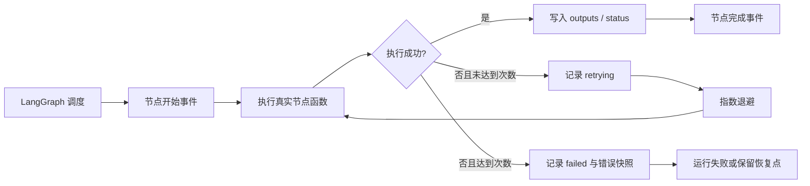

对应实现：`backend/src/merchpilot/agents/mesh/graph.py` 中的 `_with_node_retries` 和 `build_mesh_graph`。

---

## 1. Requirement Agent：需求理解

**类型**：LLM Agent  
**节点 ID**：`requirement_agent`  
**真实函数**：`requirement_agent` → `generate_requirement_analysis`  
**输出契约**：`RequirementAnalysis`

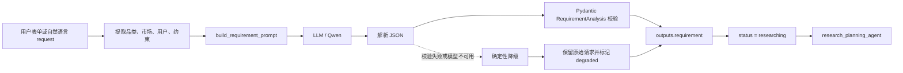

### 输入

- `state.request`
- 品类、目标市场、目标用户、价格、毛利、供应商、交期等约束。

### 输出

- `requirement.category`
- `requirement.target_market`
- `requirement.target_user`
- `requirement.constraints`
- `requirement.core_constraints`
- `requirement.success_metrics`
- `requirement.clarifying_questions`
- `requirement.assumptions`

### 边界

- 只负责把需求整理成结构化上下文。
- 不生成最终商品方案。
- 不补充未经证实的市场、价格、销量或供应商事实。

---

## 2. Research Planning Agent：研究规划

**类型**：LLM Agent  
**节点 ID**：`research_planning_agent`  
**真实函数**：`research_planning_agent` → `generate_research_plan`  
**输出契约**：`ResearchPlan`

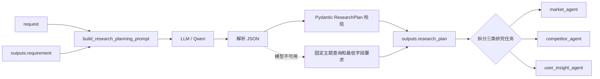

### 输入

- `state.request`
- `state.outputs.requirement`

### 输出

- `market_query`
- `competitor_query`
- `user_insight_query`
- `strategy`
- `follow_up_queries`
- `evidence_requirements`
- `rationale`

### 边界

- 只决定检索方向、查询语句和证据字段要求。
- 不直接查询数据库。
- 不把研究规划中的主观假设写成市场事实。

---

## 3. Market Tool：市场研究

**类型**：确定性检索工具  
**节点 ID**：`market_agent`  
**真实函数**：`market_agent` → `_research(state, "market", ...)`  
**主要能力**：租户隔离、字段过滤、混合检索和重排

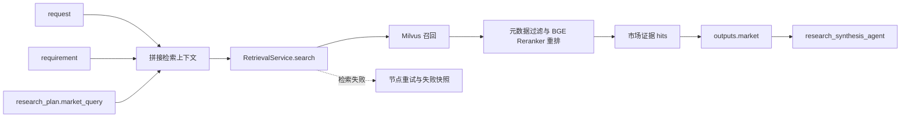

### 输入

- `request`
- `requirement.category`
- `requirement.target_market`
- `research_plan.market_query`

### 输出

- `outputs.market.hits`
- `outputs.market.evidence_ids`
- `outputs.market.retrieval_status`
- `outputs.market.retrieval_mode`
- `outputs.market.run_id`

### 边界

- 只返回带来源的市场证据。
- 不生成最终市场结论。
- 不把 Milvus 返回的候选证据直接当作权威业务事实。

---

## 4. Competitor Tool：竞品研究

**类型**：确定性检索工具  
**节点 ID**：`competitor_agent`  
**真实函数**：`competitor_agent` → `_research(state, "competitor", ...)`

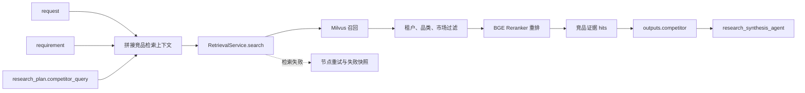

### 输入

- `request`
- `requirement.category`
- `requirement.target_market`
- `research_plan.competitor_query`

### 输出

- 竞品名称、品牌、价格、销量、卖点和来源引用。
- `outputs.competitor.evidence_ids`
- 检索状态、召回模式和运行 ID。

### 边界

- 只返回竞品证据和来源。
- 不负责生成差异化商品方案。
- 不把单条竞品信息扩展为整个市场结论。

---

## 5. User Insight Tool：用户洞察检索

**类型**：确定性检索工具  
**节点 ID**：`user_insight_agent`  
**真实函数**：`user_insight_agent` → `_research(state, "user_insight", ...)`

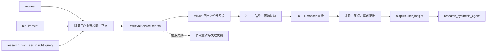

### 输入

- `request`
- `requirement.category`
- `requirement.target_market`
- `research_plan.user_insight_query`

### 输出

- 用户评价、痛点、需求标签、使用场景和评分证据。
- `outputs.user_insight.evidence_ids`
- 检索状态、召回模式和运行 ID。

### 边界

- 用户评论是用户证据，不是用户总体事实。
- 不替用户做无证据推断。
- 不直接生成最终商品需求结论。

---

## 6. Research Synthesis：证据治理

**类型**：确定性证据治理节点  
**节点 ID**：`research_synthesis_agent`  
**真实函数**：`research_synthesis_agent` → `build_research_synthesis`

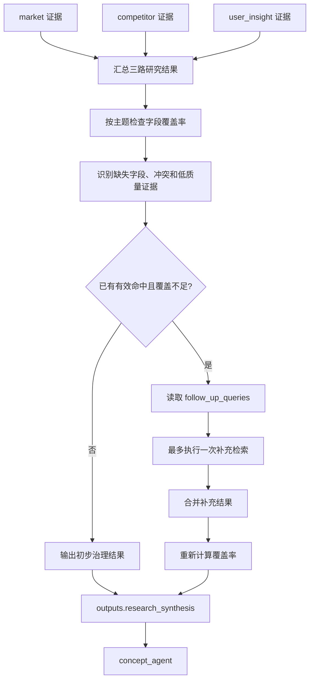

### 输入

- `research_plan`
- `market`
- `competitor`
- `user_insight`

### 输出

- `topic_assessments`
- 每个主题的覆盖率和质量状态。
- `follow_up_topics`
- `supplemented_topics`
- `research_synthesis`

### 边界

- 空结果不会被无意义地重复查询。
- 缺失字段不会被模型补成事实。
- 补充检索有次数上限，并保留 `partial` 状态。

---

## 7. Concept Agent：候选商品概念

**类型**：LLM Agent，带确定性概念降级  
**节点 ID**：`concept_agent`  
**真实函数**：`concept_agent` → `generate_concept_drafts` / `build_candidate_concepts`  
**输出契约**：`ConceptDraftSet`

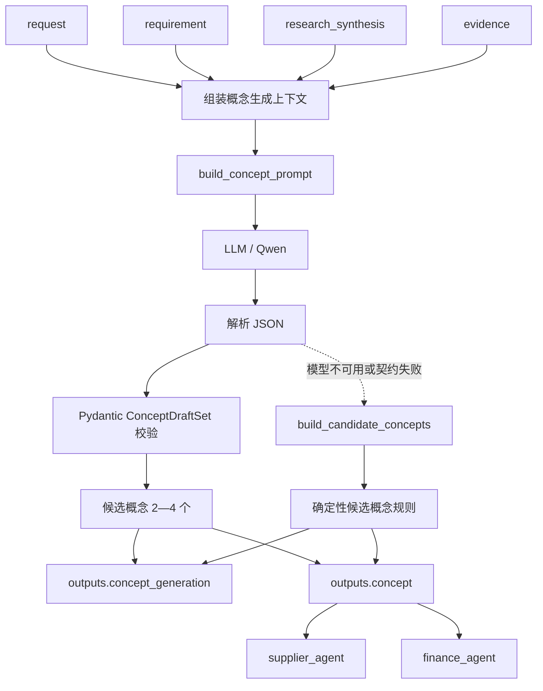

### 输入

- `request`
- `requirement`
- `research_synthesis`
- 允许引用的 `evidence`
- 可能存在的 `revision_context`

### 输出

- 候选商品名称和定位。
- 目标用户、痛点、功能假设和规格建议。
- 价格/成本参考、差异化假设和风险。
- `evidence_ids`
- 候选验证计划和 `generation_mode`。

### 边界

- LLM 只提出候选概念，不决定最终商品。
- 不能自由生成最终售价、成本、供应商或销量。
- 后续财务测算和供应评估必须使用确定性节点重新计算。

---

## 8. Supplier Tool：供应商评估

**类型**：确定性供应评估工具  
**节点 ID**：`supplier_agent`  
**真实函数**：`supplier_agent` → `evaluate_supplier_constraints`

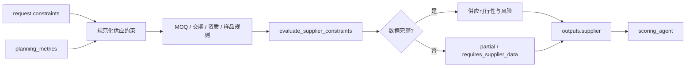

### 输入

- `request.constraints`
- `planning_metrics`

### 输出

- MOQ 判断。
- 交期判断。
- 供应商信息完整度。
- 资质、样品和可交付性风险。
- `requires_supplier_data`、`partial` 或可行状态。

### 边界

- 不替供应商做事实承诺。
- 不使用模型自由生成供应商数据。
- 缺数据时显式返回不完整，而不是伪造“可供应”。

---

## 9. Finance Engine：财务测算

**类型**：确定性财务测算引擎  
**节点 ID**：`finance_agent`  
**真实函数**：`finance_agent` → `calculate_financials` / `calculate_candidate_financials`

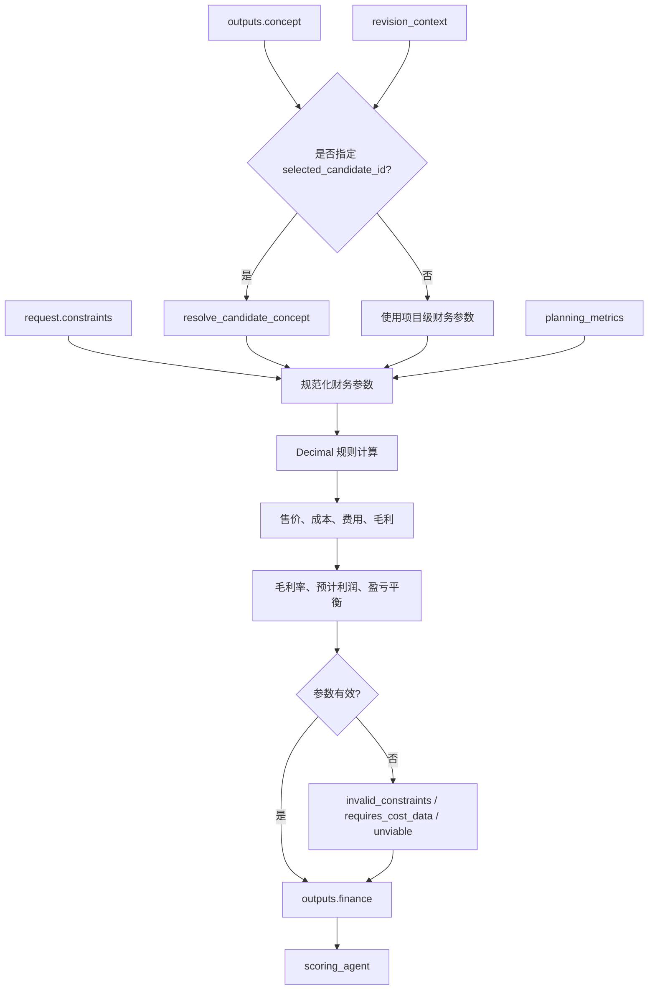

### 输入

- `request.constraints`
- `concept`
- `revision_context.selected_candidate_id`（可选）
- `planning_metrics`

### 输出

- 售价。
- 单位成本。
- 平台、物流、税费和营销费用。
- 毛利、毛利率、贡献利润。
- 预计利润。
- 盈亏平衡销量。
- 参数缺失或不可行原因。

### 边界

- 财务数字以确定性规则为准。
- 模型生成的价格/成本只能作为参考值。
- 不接受模型自由覆盖项目显式财务约束。

---

## 10. Scoring Engine：机会评分

**类型**：确定性评分引擎  
**节点 ID**：`scoring_agent`  
**真实函数**：`scoring_agent` → `build_scorecard`

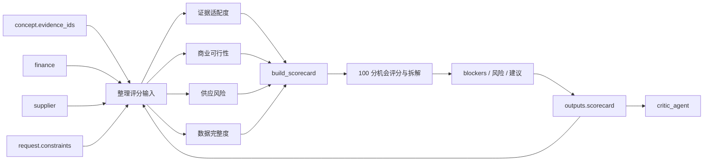

### 输入

- 候选方案引用的证据 ID。
- 财务测算结果。
- 供应商评估结果。
- 项目约束。
- 规划指标。

### 输出

- 总机会分。
- 证据、财务、供应和数据准备度分项。
- 阻断项。
- 风险提示。
- 优先验证建议。

### 边界

- 评分必须可以由输入数据复算。
- 不由 LLM 直接改分。
- 关键参数缺失时返回 `blocked` 或 `partial`，并拆解扣分原因。

---

## 11. Critic Agent：方案审查

**类型**：LLM Agent，带确定性守门  
**节点 ID**：`critic_agent`  
**真实函数**：`critic_agent` → `review_candidate_concepts` → `CriticReview`  
**输出契约**：`CriticReview`

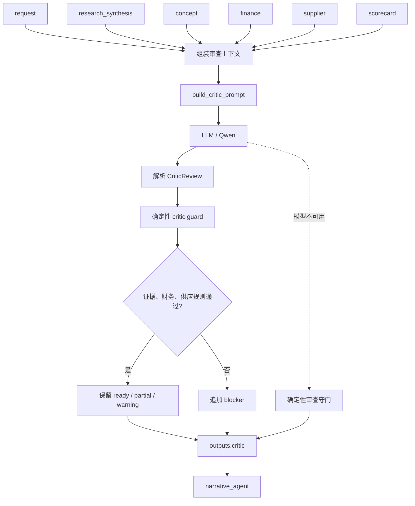

### 输入

- 项目请求和人工修订上下文。
- 证据治理结果。
- 候选概念。
- 财务结果。
- 供应结果。
- 机会评分结果。

### 输出

- `status`：`ready`、`partial` 或 `blocked`。
- 审查摘要。
- 每个候选的 blocker、warning、info。
- 证据引用问题。
- 必须修订项。
- 推荐候选 ID。

### 边界

- 模型负责反驳和解释，不负责放行。
- 确定性守门结果优先于模型自报的 `ready`。
- 发现无效证据引用或商业硬冲突时必须保留 blocker。

---

## 12. Narrative Agent：规划报告

**类型**：LLM Agent，带确定性摘要降级  
**节点 ID**：`narrative_agent`  
**真实函数**：`narrative_agent` → `generate_planning_narrative`  
**输出契约**：`NarrativeOutput`

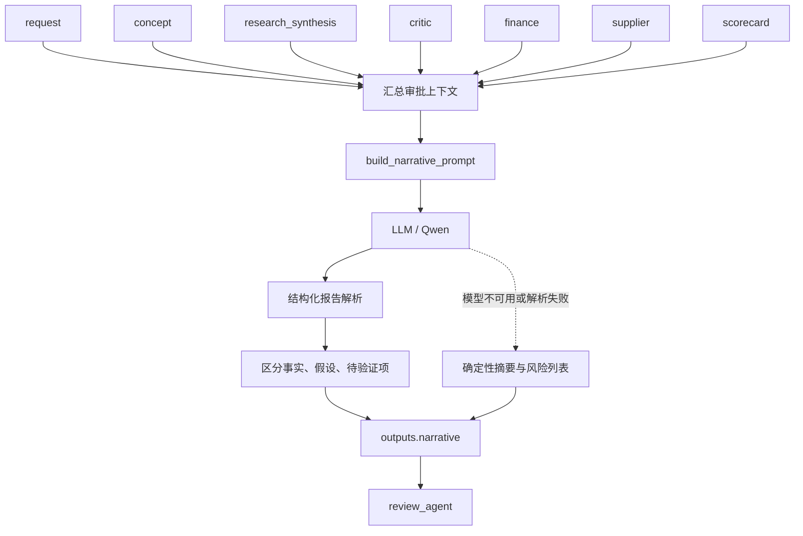

### 输入

- 项目请求。
- 候选商品概念。
- 证据治理结果。
- 方案审查结果。
- 财务、供应和评分结果。

### 输出

- 管理层摘要。
- 推荐动作。
- 风险列表。
- 事实、假设和待验证事项的区分。
- 模型或确定性降级状态。

### 边界

- 不修改 PostgreSQL 中的财务事实。
- 不隐瞒 critic blocker。
- 不替审批人做通过、修订或驳回决定。

---

## 13. Review Gate：线上人工审批门禁

**类型**：人工审批门禁  
**节点 ID**：`review_agent`  
**真实函数**：`review_agent`

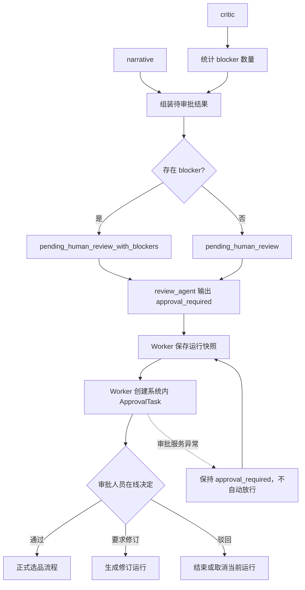

### 输入

- `outputs.critic`
- `outputs.narrative`

### 输出

- `outputs.approval_gate.status`
- `blocker_count`
- `recommended_action`
- `decision_owner`
- `approval_required = True`
- `status = approval_required`

### 边界

- 不调用 LLM。
- 不自动通过、驳回或确认上市。
- 节点只输出审批门禁状态，`Celery Worker` 负责持久化运行并创建 `ApprovalTask`。
- 它只是自动流程与人工责任之间的控制边界。

---

## 14. Multimodal Evidence Agent：多模态证据抽取

**类型**：导入流水线 LLM Agent  
**节点 ID**：`multimodal_evidence_agent`  
**真实函数**：`extract_multimodal_evidence` → `_extract_part`  
**输出契约**：`MultimodalEvidenceBatch`

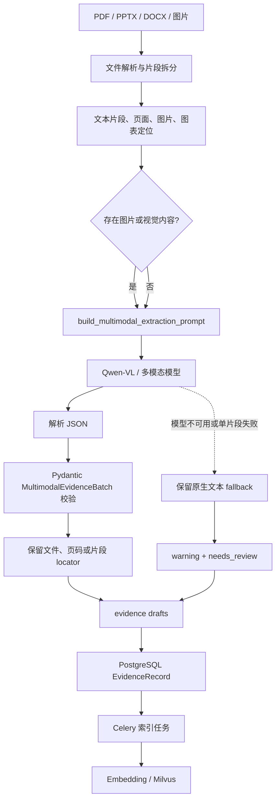

### 输入

- 上传文件内容。
- 文件名和文件类型。
- 文件片段定位。
- 文档原生文本或辅助文本。

### 输出

- `title`
- `content`
- `category`
- `target_market`
- `target_user`
- `data_type`
- `observed_at`
- `evidence_tags`
- `confidence`
- `needs_review`
- 文件片段定位和抽取摘要。

### 边界

- 无法确认的图片事实必须标记 `needs_review`。
- 模型失败时只保留可读取的原生文本。
- 抽取 Agent 不负责商品规划，不直接生成候选方案。

---

## 15. 总体连接索引

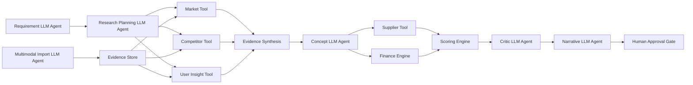

## 16. 源码对照表

| 节点 | 分类 | 源码位置 | 主要输出 |
| --- | --- | --- | --- |
| `requirement_agent` | LLM Agent | `backend/src/merchpilot/agents/mesh/graph.py` | `requirement` |
| `research_planning_agent` | LLM Agent | `backend/src/merchpilot/agents/mesh/graph.py` | `research_plan` |
| `market_agent` | 确定性检索工具 | `backend/src/merchpilot/agents/mesh/graph.py` | `market` |
| `competitor_agent` | 确定性检索工具 | `backend/src/merchpilot/agents/mesh/graph.py` | `competitor` |
| `user_insight_agent` | 确定性检索工具 | `backend/src/merchpilot/agents/mesh/graph.py` | `user_insight` |
| `research_synthesis_agent` | 证据治理节点 | `backend/src/merchpilot/agents/mesh/graph.py` | `research_synthesis` |
| `concept_agent` | LLM Agent | `backend/src/merchpilot/agents/mesh/graph.py` | `concept`、`concept_generation` |
| `supplier_agent` | 确定性供应工具 | `backend/src/merchpilot/agents/mesh/graph.py` | `supplier` |
| `finance_agent` | 确定性财务引擎 | `backend/src/merchpilot/agents/mesh/graph.py` | `finance` |
| `scoring_agent` | 确定性评分引擎 | `backend/src/merchpilot/agents/mesh/graph.py` | `scorecard` |
| `critic_agent` | LLM Agent + 守门 | `backend/src/merchpilot/agents/mesh/graph.py` | `critic` |
| `narrative_agent` | LLM Agent | `backend/src/merchpilot/agents/mesh/graph.py` | `narrative` |
| `review_agent` | 人工审批门禁 | `backend/src/merchpilot/agents/mesh/graph.py` | `approval_gate` |
| `multimodal_evidence_agent` | 导入 LLM Agent | `backend/src/merchpilot/services/multimodal_import.py` | `evidence_drafts` |

## 17. 学习顺序建议

1. 先看 `Requirement Agent` 和 `Research Planning Agent`，理解模型负责什么。
2. 再看三个并行检索工具，理解数据事实从哪里来。
3. 接着看 `Research Synthesis` 和 `Concept Agent`，理解证据如何汇合并生成候选方案。
4. 深挖 `Supplier Tool`、`Finance Engine`、`Scoring Engine`，这是确定性业务核心。
5. 最后看 `Critic Agent`、`Narrative Agent` 和人工审批门禁，理解模型建议如何进入业务责任链。
6. 单独学习多模态导入 Agent，理解文件证据如何进入 PostgreSQL、Embedding 和 Milvus。
