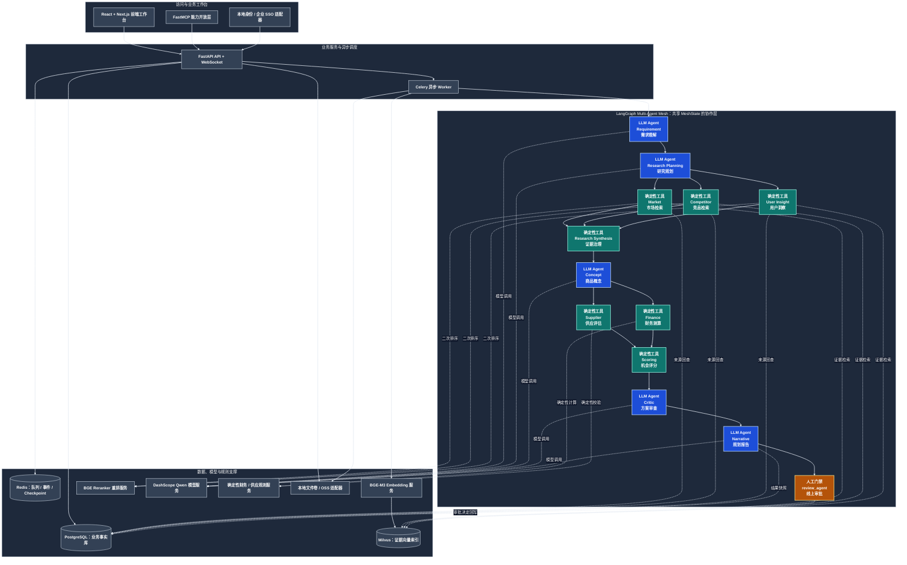

# MerchPilot 系统架构说明

本文档用中文说明 MerchPilot 的运行方式、模块边界、数据流、可靠性设计和企业扩展方式。代码中的技术名词、接口路径、环境变量和文件名保留英文，便于与源码对应。

## 1. 系统运行拓扑

简单理解这张图：

- 用户在 React 页面上操作。
- FastAPI 负责身份、权限、参数校验和业务 API。
- 长时间任务不在 API 请求中同步执行，而是交给 Celery Worker。
- Worker 负责启动 LangGraph，执行 5 个规划 LLM Agent、7 个确定性业务工具和 1 个人工审批门禁；数据导入任务另由 Qwen-VL 多模态 LLM Agent 处理非结构化文件。
- `Requirement Agent` 和 `Research Planning Agent` 先生成上下文与研究策略，三路研究工具并行执行；`Concept Agent` 汇合后再分发供应商和财务评估，最后由评分、`Critic Agent`、叙事和人工审批收敛。
- PostgreSQL 保存最终业务事实，Redis 保存任务过程中的临时状态和实时事件。
- Milvus 只负责语义检索，不能替代 PostgreSQL。
- FastMCP 不是第二套业务系统，而是给外部 Agent、IDE 或自动化工具使用的能力入口。

## 2. 架构边界

- `Celery` 负责调度规划、数据导入、向量索引和报告生成等异步任务。
- `LangGraph` 负责 Agent 节点之间的状态传递、并行分支、重试和人工审批门禁。
- `Redis` 保存当前执行中的 `Checkpoint`、事件流、锁、任务状态和临时协作数据。
- `PostgreSQL` 保存权威业务事实、审批决定、运行结果快照、审计记录和幂等记录。
- `Milvus` 保存证据向量索引，返回的是候选证据 ID，而不是权威业务对象。
- Agent 只能通过共享状态、检索服务和规则服务协作，不能绕过 FastAPI 直接修改数据库或向量库。
- 模型权重以只读方式挂载到独立的模型服务容器，避免业务容器直接修改模型文件。
- 文件统一通过 `ObjectStorageProvider` 访问。本地 Docker 使用文件卷；将来接入阿里云 OSS 时，只替换适配器，不改数据导入、报告和验证材料业务逻辑。

## 3. 身份与权限边界

- FastAPI 的每个业务请求都通过 `IdentityProvider` 解析身份，业务层只接收认证后的 `user_id`、`tenant_id` 和角色信息。
- 本地开发默认使用本地身份，便于学习和演示；企业环境可以将 `IdentityProvider` 替换为 OIDC/SSO 实现，而不修改规划、审批、证据和报告接口。
- 所有业务查询和写入都由服务端按 `tenant_id` 隔离。客户端不能通过请求参数覆盖当前租户。
- WebSocket 在建立连接前完成身份认证，并先确认运行所属项目属于当前租户，再读取 Redis 事件流。
- 租户内的认证用户可以读取允许范围内的数据；规划写入要求 `planner` 或 `admin`，审批决定要求 `approver` 或 `admin`，审计台账要求 `admin`。
- 线上审批属于 MerchPilot 系统内部能力。外部 OA 未来可以作为通知或同步适配器，但不是当前审批事实的唯一来源。

## 4. 证据导入与检索流程

1. FastAPI 提供带版本号的 37 个字段采集模板，并负责接收和保存上传的 Excel/CSV 文件。
2. Celery 使用 `pandas` 解析表格，忽略没有业务数据的空行，统一模板字段和历史字段别名，将常见的百分比、数量和单位文本转换为数值，同时把未知中文列和原始数值保存在行级元数据中。
3. 系统检查必填字段、枚举值、日期和文本长度。较短的用户评价仍保留原文，并补充品类、商品、渠道和标题上下文，方便后续检索。PostgreSQL 保存每行质量问题、导入状态、证据内容、内容哈希和来源链路。
4. Worker 按有限批次把可索引证据发送给 BGE-M3 服务。`EMBEDDING_BATCH_SIZE` 默认是 128，最大是 256。成功批次立即写入 Milvus，失败批次单独隔离，Celery 只重试尚未成功索引的记录。
5. 研究类 Agent 先把查询文本转换为向量，在 Milvus 中执行租户、品类和目标市场过滤，并预取候选证据 ID。去重和重排前，检索服务会重新检查当前租户的 PostgreSQL 证据状态，只保留未被阻断且 `index_status` 为 `indexed` 的记录。因此 Milvus 永远不是证据可用性的最终事实源。
6. 检索结果会回到 PostgreSQL 补充权威来源信息，包括来源行号、来源 ID、观察日期和经过清理的 HTTP(S) 地址。页面会区分向量分数和 Reranker 分数，不把模型分数错误显示成百分比。
7. 认证后的 `POST /api/v1/retrieval/search` 使用同一套检索流程，供本地验证和问题排查。返回内容包括证据 ID、来源信息、分数、去重治理结果和明确的降级/部分失败原因，并且不会泄露其他租户的数据。
8. 当模型服务或向量服务暂时不可用时，Agent 会记录降级原因，但主流程仍可以进入系统内线上评审，不会因为检索服务短暂故障而静默丢失运行结果。

## 5. 数据治理流程

- 质量汇总按租户统计导入状态、证据质量和向量索引状态，不暴露跨租户数据。
- 覆盖率分析统计稳定来源 ID、观察日期、数据类型、品类和市场等关键维度的完整程度。
- 重复分析识别相同来源 ID 和相同内容哈希，并展示来源链路和内容摘要，帮助业务人员人工判断。
- 规划人员和管理员可以保存租户范围内的重复审核决定：保留全部记录、选择规范记录或忽略该重复候选。每次决定都会写入审计，并绑定当时的候选指纹。
- Milvus 召回后、内容去重和重排前，检索服务会从 PostgreSQL 读取当前租户的规范记录决定。如果规范记录存在，就抑制已经审核为替代项的记录；如果规范记录不存在，则保留召回的替代记录作为兜底。来源 ID 审核和内容哈希审核冲突时，优先采用来源 ID 审核。系统不会因为去重审核直接删除 PostgreSQL 证据或 Milvus 向量。
- 已完成的导入批次可以按来源 ID 对比，识别新增、删除、修改和未变化记录，同时保留两批数据快照。
- 解析失败的任务只有在尚未生成证据记录时才能重新排队，避免重复生成证据。
- 待索引或索引失败的记录可以单独重建向量，不必重新导入原始工作簿。
- 质量报告会导出警告行和阻断行，并带上来源行号，同时对 Excel 公式注入内容进行转义。
- 批次撤回仅允许规划人员和管理员执行。系统先删除已索引的 Milvus 记录，再删除 PostgreSQL 证据批次和原始文件，并写入审计记录。

## 6. 规划决策流程

### 6.1 Agent 协作工作流

```mermaid
%%{init: {"theme":"base","themeVariables":{"background":"#0f172a","primaryColor":"#334155","primaryTextColor":"#ffffff","nodeTextColor":"#ffffff","primaryBorderColor":"#cbd5e1","lineColor":"#e2e8f0","textColor":"#ffffff","clusterBkg":"#1e293b","clusterBorder":"#cbd5e1","titleColor":"#ffffff","edgeLabelBackground":"#0f172a","edgeLabelTextColor":"#ffffff","fontSize":"17px","fontFamily":"Arial, PingFang SC, Microsoft YaHei, sans-serif"}}}%%
flowchart TD
    START([启动规划运行]) --> REQ[LLM Agent<br/>Requirement<br/>规范化需求与规划约束]
    REQ --> PLAN[LLM Agent<br/>Research Planning<br/>生成检索策略与字段要求]

    subgraph RESEARCH[并行研究阶段：确定性检索工具]
        MARKET[Market Tool<br/>市场趋势与机会]
        COMP[Competitor Tool<br/>竞品与差异化]
        INSIGHT[User Insight Tool<br/>用户痛点与场景]
    end
    PLAN --> MARKET
    PLAN --> COMP
    PLAN --> INSIGHT

    MARKET --> SYNTH[Research Synthesis Tool<br/>证据覆盖率、冲突与补充检索]
    COMP --> SYNTH
    INSIGHT --> SYNTH
    SYNTH --> CONCEPT[LLM Agent<br/>Concept<br/>生成 2—4 个候选商品概念]

    subgraph EVALUATION[并行评估阶段：确定性业务工具]
        SUPPLIER[Supplier Tool<br/>MOQ / 交期 / 供应风险]
        FINANCE[Finance Tool<br/>成本 / 毛利 / 盈亏平衡]
    end
    CONCEPT --> SUPPLIER
    CONCEPT --> FINANCE

    SUPPLIER --> SCORE[Scoring Tool<br/>输出可解释机会评分]
    FINANCE --> SCORE
    SCORE --> CRITIC[LLM Agent<br/>Critic<br/>证据、财务与供应风险审查]
    CRITIC --> NARRATIVE[LLM Agent<br/>Narrative<br/>生成推荐理由与风险摘要]
    NARRATIVE --> REVIEW[review_agent<br/>创建线上审批任务]
    REVIEW --> WAIT[(approval_required<br/>保存 Checkpoint 并暂停)]
    WAIT --> HUMAN{审批人员在线决定}

    HUMAN -->|通过| SELECTED[正式选品台账]
    HUMAN -->|要求修订| REVISION[创建子运行<br/>继承必要材料与上下文]
    HUMAN -->|驳回| REJECT[结束运行<br/>保留完整历史]
    REVISION --> REQ

    SELECTED --> GATES[四道验证门<br/>需求 / 样品 / 商业 / 供应]
    GATES --> INITIATIVE[商品立项五里程碑]
    INITIATIVE --> PILOT[小批量试销与经营评估]
    PILOT --> LAUNCH[上市准备评审]
    LAUNCH --> END([上市确认或形成复盘记录])

    REQ -.节点事件.-> EVENTS[(Redis Stream / WebSocket)]
    MARKET -.证据检索.-> RETRIEVAL[(Milvus + PostgreSQL 权威回查)]
    COMP -.证据检索.-> RETRIEVAL
    INSIGHT -.证据检索.-> RETRIEVAL
    FINANCE -.确定性规则.-> RULES[Finance / Supplier Rules]
    SUPPLIER -.确定性规则.-> RULES

    classDef flow fill:#334155,stroke:#cbd5e1,stroke-width:1.5px,color:#ffffff,font-weight:700;
    classDef prompt fill:#1d4ed8,stroke:#bfdbfe,stroke-width:2px,color:#ffffff,font-weight:700;
    classDef tool fill:#0f766e,stroke:#99f6e4,stroke-width:2px,color:#ffffff,font-weight:700;
    classDef control fill:#b45309,stroke:#fde68a,stroke-width:2px,color:#ffffff,font-weight:700;
    class START,WAIT,SELECTED,REVISION,REJECT,GATES,INITIATIVE,PILOT,LAUNCH,END,EVENTS,RETRIEVAL,RULES flow;
    class REQ,PLAN,CONCEPT,CRITIC,NARRATIVE prompt;
    class MARKET,COMP,INSIGHT,SYNTH,SUPPLIER,FINANCE,SCORE tool;
    class HUMAN,REVIEW control;
    style START fill:#334155,stroke:#cbd5e1,color:#ffffff
    style REQ fill:#1d4ed8,stroke:#bfdbfe,color:#ffffff
    style PLAN fill:#1d4ed8,stroke:#bfdbfe,color:#ffffff
    style MARKET fill:#0f766e,stroke:#99f6e4,color:#ffffff
    style COMP fill:#0f766e,stroke:#99f6e4,color:#ffffff
    style INSIGHT fill:#0f766e,stroke:#99f6e4,color:#ffffff
    style SYNTH fill:#0f766e,stroke:#99f6e4,color:#ffffff
    style CONCEPT fill:#1d4ed8,stroke:#bfdbfe,color:#ffffff
    style SUPPLIER fill:#0f766e,stroke:#99f6e4,color:#ffffff
    style FINANCE fill:#0f766e,stroke:#99f6e4,color:#ffffff
    style SCORE fill:#0f766e,stroke:#99f6e4,color:#ffffff
    style CRITIC fill:#1d4ed8,stroke:#bfdbfe,color:#ffffff
    style NARRATIVE fill:#1d4ed8,stroke:#bfdbfe,color:#ffffff
    style REVIEW fill:#b45309,stroke:#fde68a,color:#ffffff
    style WAIT fill:#334155,stroke:#cbd5e1,color:#ffffff
    style HUMAN fill:#b45309,stroke:#fde68a,color:#ffffff
    style SELECTED fill:#334155,stroke:#cbd5e1,color:#ffffff
    style REVISION fill:#334155,stroke:#cbd5e1,color:#ffffff
    style REJECT fill:#334155,stroke:#cbd5e1,color:#ffffff
    style GATES fill:#334155,stroke:#cbd5e1,color:#ffffff
    style INITIATIVE fill:#334155,stroke:#cbd5e1,color:#ffffff
    style PILOT fill:#334155,stroke:#cbd5e1,color:#ffffff
    style LAUNCH fill:#334155,stroke:#cbd5e1,color:#ffffff
    style END fill:#334155,stroke:#cbd5e1,color:#ffffff
    style EVENTS fill:#334155,stroke:#cbd5e1,color:#ffffff
    style RETRIEVAL fill:#334155,stroke:#cbd5e1,color:#ffffff
    style RULES fill:#334155,stroke:#cbd5e1,color:#ffffff
    linkStyle default stroke:#e2e8f0,stroke-width:2px;
```

这张图用于说明执行顺序和协作边界：实线是工作流依赖，分叉是可并行执行，汇合是等待上游结果；虚线是共享能力调用。蓝色节点是 LLM Agent，青绿色节点是确定性检索或业务工具，橙色节点是人工审批门禁。`review_agent` 只负责创建审批任务并结束自动链，审批人员的在线决定才会驱动正式选品、修订或驳回。

一次规划运行的主要步骤如下：

1. `Requirement Agent` 规范化品类、目标市场和规划约束。
2. `Market Tool`、`Competitor Tool`、`User Insight Tool` 并行检索市场、竞品和用户证据。
3. `Concept Agent` 综合竞品、用户洞察和规划指标，生成 2—4 个可比较的候选商品概念。每个概念包含定位、目标用户、证据特征、用户痛点、功能假设、价格/成本参考、差异化假设和验证风险，并生成由证据适配度、商业可行性、数据准备度组成的 100 分候选评分。
4. 每个候选概念还会生成四道验证门：需求匹配、规格/样品准备、商业可行性和供应交付。审批人员可以通过候选 ID 选择方案，Worker 会根据不可变的审批摘要校验候选 ID，并把最终选择写入运行快照。
5. 候选财务场景优先使用项目明确约束，只有缺少输入时才使用候选方案的价格和成本参考。审批后，选中的候选方向会重新计算财务、评分和叙事结果；修订运行会携带选中候选 ID，保证方向一致。
6. 规划人员可以通过 `PATCH /planning-projects/{project_id}/runs/{run_id}/validation-plan` 更新一个或多个验证门。接口会校验租户、候选 ID 和门禁 ID，重新计算完成度和状态，将操作人和备注写入运行快照，并发布 Redis 运行事件。
7. 验证门支持材料上传、下载和删除。材料元数据保存在运行快照中，文件字节由本地对象存储适配器负责；未来替换 OSS 时 API 契约保持不变。
8. 审批预览会重新加载最新运行快照，确保新增加的验证状态和材料能够显示；审批决定仍然必须依据不可变审批摘要规范化候选 ID。
9. 修订运行会继承父运行的验证状态、备注和材料元数据。材料字节复制到子运行存储键，并通过 `source_run_id`、`source_material_id` 保留血缘关系。
10. `Supplier Tool` 评估供应商信息完整性、MOQ、交期限制和供应风险。
11. `Finance Tool` 使用确定性的 Decimal 计算毛利、毛利率、盈亏平衡销量、收入和预计利润。
12. `Scoring Tool` 综合证据、财务、供应商和完整性维度，生成可解释的 100 分机会评分。
13. `Narrative Agent` 把结构化结果转换成建议、风险和管理层摘要。
14. `review_agent` 创建系统内线上审批任务，把运行状态变为 `approval_required`。它只是人工决策门禁，不会替审批人员自动通过、驳回或确认上市。

在图执行开始前，Worker 会根据当前租户、品类和目标市场，从已导入证据元数据构建规划指标快照。快照包含价格、销量、库存、趋势、评价标签、成本和供应商候选。财务和供应商 Agent 只能用它补充缺失输入或推荐候选，项目中明确填写的约束始终优先。快照会和运行一起持久化，便于复现，并在结果页展示数据覆盖率和输入来源。

运行证据接口会汇总 Market、Competitor、User Insight 输出中的证据引用，再关联当前租户的 PostgreSQL 证据，补充最新来源链路和质量状态。如果来源批次后来被撤回，运行快照中的历史结果仍然可以用于复盘。

## 7. 可靠性规则

- 项目归档和业务状态相互独立。`archived_at`、`archived_by` 只负责把项目从日常列表和机会分析中隐藏，不会覆盖 `draft`、`completed`、`failed` 或 `cancelled` 等业务状态。
- 已归档项目仍然可以查看完整的运行、审批、证据、验证材料、审计和报告历史。修改参数、创建新运行、恢复失败运行、更新验证状态和修改材料前必须先恢复项目。
- 项目行锁和活动运行检查共同防止同一个项目被并发启动多个运行。
- 审批决定会同时锁定审批记录和运行记录，并拒绝已经过期的状态，防止多人处理同一份旧审批。
- Redis 事件发布属于非关键路径；即使实时推送失败，PostgreSQL 运行快照仍然是权威结果。
- 运行事件历史接口按租户权限从 Redis Stream 读取，并按时间顺序返回；前端再按事件 ID 与 WebSocket 增量事件合并。
- 可恢复审批流程所需的 Redis Checkpoint 仍属于关键能力。如果恢复失败，系统会把运行记为失败，而不是留下一个无限等待的审批任务。
- Agent 的部分输出会保存在失败运行快照中，便于定位失败节点和排查数据。
- 每个 Agent 节点都会在运行快照中记录 `running`、`retrying`、`completed`、`reused` 或 `failed` 状态，以及尝试次数和错误信息。
- Agent 节点使用可配置的指数退避重试。重试耗尽后，规划人员可以恢复同一条失败运行；已经完成的节点会跳过，并复用持久化输出。
- Celery 任务在 `asyncio.run` 事件循环结束前释放异步 PostgreSQL 连接池和缓存 Redis 客户端，避免后续任务复用绑定到旧事件循环的连接。
- Docker 集成测试使用隔离的 `merchpilot_test` 数据库，覆盖项目、运行、审批、导入、分析、报告和审计接口的租户隔离与角色权限。
- 模型镜像先安装固定版本的 CPU-only PyTorch，再安装应用依赖，避免 ARM Linux 构建时错误解析大量 CUDA 依赖，同时让后续源码重建更容易利用缓存。
- 本地 BGE Reranker 使用 Transformers 序列分类推理，并对旧版离线模型包提供 SentencePiece/XLM-R 兼容回退。

## 8. FastMCP 业务能力适配层

- FastMCP 4.0.1 以独立服务运行，不替换 React 前端，也不替换 FastAPI 业务 API。
- MCP 复用现有身份、租户隔离、角色权限、审计、分页、检索治理和业务服务，不能通过直接访问数据库或 Milvus 绕过这些规则。
- React 工作台中的“Agent 集成”模块通过 `/api/v1/integrations/mcp` 检查 MCP 状态。FastAPI 会探测 Docker 内部的 MCP 服务、转发当前凭证进行协议验证、分页返回工具目录，并生成可以复制的客户端配置；浏览器不会暴露已保存的完整 Token。
- `/api/v1/integrations/mcp/verify` 调用只读的 `get_business_dashboard` 工具，返回有边界的租户统计，用一次用户可见操作验证服务健康、Bearer 鉴权、MCP 传输、API 转发和租户隔离。
- 当前 `mcp/server.py` 注册 11 个只读工具和 6 个受控写入工具。规划人员和管理员可以幂等创建规划草稿、复核配置指纹并明确确认启动 Agent；审批人员可以在权限范围内认领任务和提交决定；普通 viewer 不会获得写入工具。
- 通用幂等记录按租户、操作者、操作名和请求键隔离。项目创建、响应快照和审计事件在同一个 PostgreSQL 事务中提交，网络重试不会重复创建。
- 启动 Agent 必须提供最新的 SHA-256 项目配置指纹和精确的 `START_AGENT_ANALYSIS` 确认词。运行记录、审计事件和幂等账本会在 Celery 投递前原子提交；重放请求返回原运行，不会再次投递任务；过期指纹或内容变化后的复用请求会被拒绝。
- Agent 集成模块读取租户范围内、仅对规划人员和管理员开放的活动投影。MCP 创建项目和启动运行的事件会按项目合并、去重和排序，确保 MCP 创建项目、Web 创建项目和 MCP 启动运行都能在页面中正确显示。
- 工具的详细边界、部署方式和验收标准见 `docs/fastmcp-integration.md`。

## 9. 项目历史与审计

- 只有在项目不存在排队中、执行中或待审批运行时，才能编辑项目配置。
- 编辑已经结束的项目会将项目状态重置为草稿，但保留所有历史运行快照。
- 运行历史在运行级别不可变：每次运行保存独立的输入快照、结果快照、状态和时间。
- PostgreSQL 的 `audit_events` 记录项目、运行、审批和导入动作，包括操作者、实体、项目、详情和发生时间。
- 首页活动记录读取审计表，而不是展示静态演示数据。
- 就绪检查会区分核心依赖 PostgreSQL、Redis、Milvus 和可选模型服务 Embedding、Reranker，避免把模型服务未启动误判成业务数据库故障。

## 10. 分析与报告生成

- 驾驶舱和通知接口在 PostgreSQL 中聚合租户范围内的统计，只返回页面直接导航所需的最新记录，避免浏览器周期性读取整张业务表。
- 机会分析把每个规划项目和最新运行关联起来，从权威运行快照中提取评分、毛利、证据数和供应风险。AntV 图表只读取有限数量的最新数据，而不是读取所有项目。
- 数据质量汇总返回受影响导入批次总数，同时最多返回 10 个代表性批次，保证数据量增长后首页仍然稳定。
- XLSX 导出会先创建 PostgreSQL 报告任务，再把生成任务投递到 Celery 的 `report.generate` 队列。
- Worker 使用 `pandas` 和 `openpyxl` 生成汇总、评分拆解、约束条件和证据工作表，然后通过本地对象存储适配器保存文件。
- 写入 Excel 前会中和用户导入或模型生成的文本，防止公式注入。
- 报告状态变化和项目、运行、审批、导入动作一起写入 PostgreSQL 审计流。

## 11. 正式选品台账

- 审批通过的规划运行会创建一条以运行 ID 为来源的 `selected_products` 正式选品记录。
- 台账保存选中的候选方案、业务指标、供应商状态、验证状态、负责人和权威审批快照。
- 规划人员和管理员只能修改运营状态、负责人和备注，不能覆盖原始审批快照和运行快照。
- 验证计划更新会在同一个 PostgreSQL 事务中同步候选方案的验证状态。正常记录会从 selected 进入 validating，再进入 ready；暂停和终止记录保持人工控制。
- 正式选品详情读取当前租户范围内的最新规划运行和证据，而不是只展示审批时的旧快照。
- 租户内 viewer 可以读取正式选品专属的审计时间线，但不能读取管理员范围的全局审计接口。
- 没有候选数组的历史审批运行会被补齐为历史候选方案，不会被静默丢弃。
- 驾驶舱统计、提醒和正式选品池都通过租户范围内的正式选品 API 获取数据。

## 12. 商品立项与上市评审

- 验证状态为 ready 的正式选品可以创建一条租户范围内的 `product_initiatives` 商品立项记录，且同一正式选品只能创建一次。
- 创建立项时，系统在一个事务中把正式选品移动到 `initiated`，并写入立项和正式选品两条审计事件。
- 每个立项固定包含五个执行里程碑：项目启动、样品定版、成本定版、小批量试销和上市准备评审。
- 里程碑更新会把负责人、截止日期、状态、备注、更新人和更新时间保存到 PostgreSQL；全部里程碑完成后，立项自动进入 `launch_ready`。
- 只有全部里程碑完成，系统才允许确认上市；确认成功后，正式选品原子地进入 `launched`。
- 租户内 viewer 可以读取立项和时间线；planner 和 admin 可以创建立项、更新里程碑、暂停、恢复和确认上市。
- 审计写入使用 PostgreSQL `CURRENT_TIMESTAMP(6)` 和 `DATETIME(6)` 作为统一展示时间。数据库生成的 `sequence_no` 作为审计表主键和权威排序键，保证并发或相同时间的事件仍然有确定顺序。
- 试销记录是商品立项的租户范围子记录，保存报告周期、渠道、流量、订单、销量、收入、商品成本、营销投入、退款、退货、评分和备注。
- API 根据试销数据计算转化率、退货率、客单价、实际毛利、实际毛利率、营销 ROI、平均评分，以及相对于审批选品计划的毛利差距。
- 规划人员可以修改试销记录。接口会重新校验完整业务数据，并将修改前后快照和变化字段写入立项审计时间线。
- 趋势接口按报告周期和渠道聚合数据，前端展示收入/利润趋势和渠道对比，不额外建设一套分析数据库。
- 同一租户、同一立项、同一报告周期和同一渠道的组合必须唯一。API 会先返回可读的冲突提示，PostgreSQL 唯一约束继续保护并发写入。
- 上市准备预检综合里程碑、试销评估、负责人、目标上市日期和预算完整性，返回 `ready`、`review` 或 `blocked`，但不会自动修改立项状态；最终确认仍然是规划人员的明确操作。
- 上市准备评审单独保存为 `product_launch_reviews` 记录。规划人员提交当前预检快照，审批人员决定 `approved`、`revision_required` 或 `rejected`；决定结果会同步上市评审里程碑，并保留提交/决定备注、操作者、时间和不可变准备快照。
- 租户级 `GET /product-initiatives/launch-reviews?status=pending` 接口为通知中心提供待审批上市评审，审批人员不需要逐个打开立项才能发现待办。
- 试销摘要会确定性地返回 `insufficient`、`recommended`、`review` 或 `blocked`，并给出风险和下一步建议。零订单、利润不大于 0、退货率超过 20%、评分低于 3 或毛利为负时，会阻断后续推进。
- 里程碑必须按依赖顺序完成。小批量试销和上市准备评审还要求至少存在一条试销记录；试销评估为 blocked 时，不能完成这两个里程碑。
- 第一条试销记录产生时，如果立项处于 active，系统会自动启动小批量试销里程碑；暂停、取消或已上市立项仍由人工控制。

## 13. 阿里云和企业系统扩展点

应用层依赖的是 Provider 接口，而不是直接依赖云厂商 SDK。因此接入阿里云时，可以新增实现而不修改规划、Agent、审批和证据领域逻辑。

- `OBJECT_STORAGE_PROVIDER` 选择对象存储适配器，并在 API 启动时校验。
- `AUTH_MODE` 选择身份适配器；生产环境默认拒绝继续使用本地身份认证。
- `EXTERNAL_APPROVAL_PROVIDER` 和 `TELEMETRY_PROVIDER` 通过 Provider 工厂校验，本地默认使用内部审批和控制台日志。
- 审计遥测属于尽力而为，只发送标识、归属、操作名称和变化字段名；权威审计记录仍然保存在 PostgreSQL。
- 就绪接口会分别展示核心基础设施健康状态和企业集成 Provider 配置状态，避免本地核心服务健康掩盖企业适配器尚未配置的问题。

## 14. 先记住的架构结论

如果你刚开始学习，只需要先记住下面 6 句话：

1. **PostgreSQL 管业务事实**：项目、运行、审批、选品、立项和审计都以它为准。
2. **Redis 管过程状态**：Celery 队列、Checkpoint、锁和实时事件放在这里。
3. **Milvus 管语义检索**：它帮助 Agent 找证据，但不决定证据是否有效。
4. **Celery 管长任务**：导入、向量化、Agent 运行和报告生成不能阻塞 API 请求。
5. **LangGraph 管节点协作**：5 个 LLM Agent 负责需要推理的环节，7 个确定性工具负责证据和商业计算，`review_agent` 只负责把流程交给人工审批。
6. **FastMCP 管能力开放**：外部 Agent 可以调用受控工具，但不能绕过现有权限、审批、幂等和审计规则。
