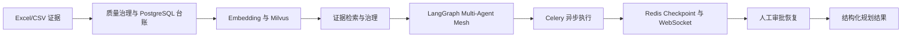
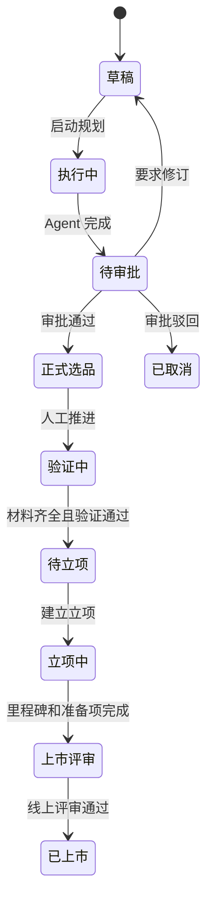

# 面试学习与开发分工边界

> 当前推荐版本：项目逐字稿、简历项目经历和问答口径已统一整理到 `docs/面试项目逐字稿_2026版.md`、`docs/简历项目经历_2026版.md` 和 `docs/面试问答与表述边界_2026版.md`。

> 适用日期：2026 年 9 月 4 日
>
> 本文用于区分“需要理解整个系统”和“适合个人深度负责”的范围，避免为了展示项目而平均学习所有代码。

## 1. 结论

当前 MerchPilot 的功能覆盖已经足够支撑以下面试内容：

- 企业级 AI 应用的整体架构设计。
- RAG 数据治理、向量检索和证据可追溯设计。
- LangGraph Multi-Agent Mesh 的节点编排、失败重试和人工审批中断。
- Celery、Redis、PostgreSQL、Milvus、WebSocket 组成的异步业务链路。
- 多租户、角色权限、幂等、审计和状态机等企业级约束。
- 从商品规划到审批、正式选品、验证、立项和上市评审的业务闭环。

但面试不要求个人能够逐个解释所有页面、所有接口和所有基础设施适配器。更合理的方式是：

> **整体架构能讲清楚，核心方向能讲到代码、数据流、异常处理和测试，其他模块能说明职责与边界。**

## 2. 推荐个人主责方向

### 2.1 主方向：证据驱动的异步 Multi-Agent 规划链路

这是最适合用于面试深挖的方向，既能体现 AI 应用能力，也能体现企业后端工程能力。

主方向覆盖以下链路：

建议深挖的代码范围：

| 主题 | 重点文件 | 面试要点 |
| --- | --- | --- |
| 证据导入 | `backend/src/merchpilot/services/tabular_import.py`、`backend/src/merchpilot/services/data_import.py` | Excel/CSV 解析、字段归一化、质量问题和来源追踪 |
| 检索治理 | `backend/src/merchpilot/services/retrieval.py`、`backend/src/merchpilot/services/retrieval_governance.py` | Milvus 不是事实源、PostgreSQL 二次校验、租户和质量过滤 |
| Agent 编排 | `backend/src/merchpilot/agents/mesh/graph.py` | 节点依赖、并行分支、重试、结构化结果和人工门禁 |
| 异步任务 | `backend/src/merchpilot/workers/tasks.py` | Celery 投递、状态回写、失败恢复、重复执行保护 |
| 状态持久化 | `backend/src/merchpilot/infrastructure/checkpoints.py` | Redis 临时状态、PostgreSQL 最终快照、降级恢复 |
| 规划入口 | `backend/src/merchpilot/api/routes/projects.py` | 参数校验、运行状态、审批提交和验证门禁 |
| 前端反馈 | `frontend/src/components/planning-workspace.tsx`、`frontend/src/lib/ws/` | Axios、WebSocket、刷新恢复和用户可见进度 |

### 2.2 关联方向：业务状态闭环

这部分不需要逐行掌握，但必须能画出状态流并解释关键约束：

需要理解的核心规则：

- 审批通过才允许创建正式选品，不能由前端直接伪造状态。
- 验证门禁标记通过前必须存在可用人工材料。
- 商品立项和上市评审有各自的准备条件，不能直接跳过。
- PostgreSQL 保存业务事实，Redis 只负责临时状态、事件和恢复辅助。
- 每个状态变更都应带操作人、时间、来源和审计记录。

重点阅读文件：

- `backend/src/merchpilot/services/project_lifecycle.py`
- `backend/src/merchpilot/services/validation_guard.py`
- `backend/src/merchpilot/services/launch_review_guard.py`
- `backend/src/merchpilot/api/routes/product_initiatives.py`
- `frontend/src/components/product-initiative-panel.tsx`

## 3. 必须掌握的整体结构

| 层次 | 需要讲清楚的内容 | 不要求一开始深挖 |
| --- | --- | --- |
| 用户层 | React/Next.js 工作台、分页、筛选、详情和实时进度 | 每个 CSS 细节 |
| 接口层 | FastAPI 路由、Schema、身份依赖和错误码 | 每条辅助查询接口 |
| 业务层 | 规划、审批、选品、验证、立项和上市状态 | 所有报表字段 |
| Agent 层 | 5 个 LLM Agent、7 个确定性工具、共享状态和人工审批节点 | 每个 Prompt 的细节微调 |
| 异步层 | Celery + Redis、Checkpoint、WebSocket 事件 | 所有运维脚本 |
| 数据层 | PostgreSQL 事实库、Milvus 向量库、对象存储适配器 | OSS 的正式 SDK 接入 |
| 集成层 | FastMCP、SSO、OA、监控适配器和 Docker | 企业环境的具体配置 |

## 4. 可以作为个人开发任务的范围

如果需要在团队分工中明确“你负责什么”，建议选择下面这一组，而不是声称独立完成全部项目：

### 核心交付

1. 负责证据检索和 Multi-Agent 规划主链路。
2. 负责长任务的 Celery 执行、Redis Checkpoint 和失败恢复。
3. 负责规划结果进入人工审批前的结构化输出和证据引用。
4. 负责至少一组跨租户、失败重试、幂等或审批恢复测试。

### 协同交付

1. 配合前端接入规划接口、实时进度和审批结果。
2. 配合业务同学确认验证门禁、立项和上市评审规则。
3. 配合部署同学完成 Docker Compose、本地 PostgreSQL、Redis 和 Milvus 联调。

### 了解但不必主责

1. 数据治理页面的全部交互细节。
2. 全部报表模板和图表视觉优化。
3. 企业 SSO、OA、阿里云 OSS 和生产监控的正式接入。
4. FastMCP 全部工具的实现细节，只需理解其权限和确认门禁。

## 5. 面试准备顺序

### 第一阶段：先建立全局地图

阅读顺序：

1. `docs/architecture.md`
2. `docs/code-reading-guide.md`
3. `frontend/src/components/dashboard-shell.tsx`
4. `backend/src/merchpilot/api/router.py`
5. `backend/src/merchpilot/services/project_lifecycle.py`

目标是能够用 3 分钟说清楚：用户从哪里进入、数据如何进入系统、Agent 如何执行、审批如何介入、结果如何沉淀。

### 第二阶段：深挖个人主责链路

阅读顺序：

1. `backend/src/merchpilot/services/retrieval.py`
2. `backend/src/merchpilot/agents/mesh/graph.py`
3. `backend/src/merchpilot/workers/tasks.py`
4. `backend/src/merchpilot/infrastructure/checkpoints.py`
5. `backend/src/merchpilot/api/routes/projects.py`
6. `backend/tests/test_agents.py` 及相关集成测试

目标是能够回答：为什么这样拆 Agent、如何控制幻觉、检索失败怎么办、任务重复怎么办、审批等待期间状态放在哪里、服务重启后如何恢复。

### 第三阶段：掌握业务闭环和前端体验

阅读规划工作台、审批中心、正式选品台账和商品立项工作台，重点理解模块之间通过项目 ID、运行 ID、候选 ID 和业务状态连接，而不是逐个记页面实现。

### 第四阶段：准备面试材料

至少准备以下 4 张图或讲解材料：

1. 系统部署拓扑图。
2. 一次规划运行的时序图。
3. Agent Mesh 节点和人工审批状态图。
4. PostgreSQL、Redis、Milvus 的数据职责对比表。

## 6. 面试表述边界

推荐使用“我主要负责/我重点参与”描述个人工作，不要把团队协作模块全部说成个人独立完成。可以按以下结构组织回答：

> 我主要负责证据驱动的异步 Multi-Agent 规划链路，重点处理了数据检索、Agent 编排、Celery 长任务、Redis Checkpoint 和人工审批恢复。系统整体还包括正式选品、验证、立项和上市评审，我能够从架构和状态流上说明这些模块如何协同，但没有把所有前端页面和企业外部系统接入都作为个人主责。

遇到追问时，优先围绕真实代码和测试展开：

- 一次请求如何经过 API、Celery、Agent、Redis、PostgreSQL 和 WebSocket。
- Milvus 返回的为什么只是候选证据，最终可见性为什么还要回 PostgreSQL 校验。
- 为什么审批必须在系统内完成，为什么不能由 Agent 自动通过。
- Redis 不可用时如何用 PostgreSQL 运行快照恢复业务状态。
- 如何保证多租户数据隔离、重复提交幂等和状态变更可审计。

## 7. 当前结论与后续取舍

当前项目已经达到“整体结构完整、核心方向可深挖、页面可以演示”的面试项目标准。后续开发不再平均扩展所有低频功能，而按以下优先级执行：

1. 优先保证规划、审批、选品、验证、立项和上市评审主链路可操作。
2. 优先完善核心链路的异常处理、状态一致性和可验证测试。
3. 低优先级报表细节、深度视觉优化和企业外部系统接入保留接口即可。
4. 每完成一个大的核心方向再做统一回归，不在每个小改动后重复消耗回归时间。
