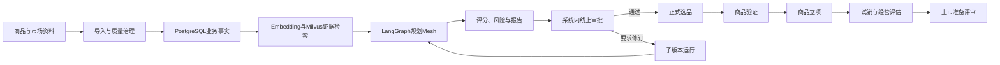

# 品策智选 MerchPilot｜面试项目逐字稿（2026 当前版）

> 更新日期：2026 年 9 月 8 日  
> 适用场景：面试项目介绍、技术面试深挖、项目复盘、系统学习  
> 事实原则：项目已在企业内部落地，完成阿里云部署上线并供内部使用；当前代码仓库为脱敏后的本地开发与学习版本，企业真实配置、密钥和业务数据不纳入仓库。面试时不虚构具体生产指标。

## 一、先记住项目定位

### 1.1 一句话

MerchPilot 是一个面向零售商品企划和智能选品的企业级业务平台。它把 Excel/CSV 及多模态商品资料经过质量治理后沉淀为可追溯证据，再用 LangGraph 编排“模型推理、确定性业务工具和线上人工审批”，完成从需求分析、市场研究、商品概念、供应与财务评估到正式选品、商品立项、试销和上市评审的业务闭环。

### 1.2 30秒版本

这个项目解决的是商品规划过程中数据分散、分析依赖经验、模型结论缺少证据以及审批和后续落地断裂的问题。系统先把商品、竞品、市场趋势、用户评论、供应商和成本数据导入并治理，业务事实和审计落在 PostgreSQL，证据向量落在 Milvus。规划任务通过 Celery 异步执行，LangGraph 负责节点编排，Redis 保存队列、Checkpoint、事件和锁，React/Next.js 工作台通过 WebSocket 展示实时进度。模型只负责理解、规划、生成和审查，财务、供应和状态流转由确定性代码与业务接口控制，最终由审批人员在线确认。

### 1.3 3分钟逐字稿

> 我参与的是一个零售商品企划和智能选品平台，项目名称叫 MerchPilot。它不是单纯让大模型生成一份商品报告，而是把商品规划做成一条可执行、可审批、可追溯的业务流程。
>
> 业务上，商品规划人员需要同时参考历史商品、竞品、市场趋势、用户评论、供应商和成本数据。但这些数据通常分散在 Excel 和不同系统里，口径不一致，选品依赖经验，模型推荐也可能缺少证据，审批通过后还要人工搬运到正式选品和后续商品流程。
>
> 我们先做数据治理。业务人员可以上传 Excel、CSV、PDF、PPTX、DOCX 和图片，表格由 pandas/openpyxl 处理，接口和结构化结果由 Pydantic 校验。业务事实、来源、质量问题、索引状态和审计记录写入 PostgreSQL；证据经 BGE-M3 向量化后写入 Milvus。Milvus 只负责召回候选证据，租户、质量和来源校验还要回 PostgreSQL 完成。
>
> 规划执行采用 LangGraph StateGraph。当前规划 Mesh 有 13 个可审计节点：5 个 LLM Agent、7 个确定性业务工具和 1 个线上人工审批门禁。LLM Agent 负责需求理解、研究规划、商品概念、方案审查和规划报告；市场、竞品、用户洞察、证据治理、供应评估、财务测算和机会评分由检索或规则服务完成。导入链路另有 1 个多模态证据抽取 LLM Agent，不计入规划 Mesh。
>
> 节点依赖上，需求理解后生成研究规划，市场、竞品和用户洞察三路并行；证据治理后生成商品概念，供应评估和财务测算再并行，最后进入评分、审查、报告和人工审批。这样既利用模型处理非结构化信息，也不让模型直接决定毛利、供应风险或业务状态。
>
> 长任务不在 HTTP 请求中同步执行。API 创建运行记录和审计事件后，把导入、索引、规划和报告任务投递到 Celery；Redis负责队列、Checkpoint、事件和锁。每个节点记录生命周期、尝试次数、错误和运行快照，失败时只重试当前节点。Redis Checkpoint丢失时，可以利用 PostgreSQL运行快照恢复已完成节点。
>
> 审批是系统内的正式业务门禁。审批人员可以领取、转派、通过、驳回或要求修订；要求修订不会覆盖原运行，而是创建带父运行和版本号的子运行，保留证据、意见和审计。审批通过后才登记正式选品，满足验证规则后再进入商品立项、试销和上市评审。
>
> 前端使用 React、Next.js、Redux Toolkit、Ant Design、AntV、Axios和WebSocket，提供数据治理、规划、Agent Mesh、审批、正式选品、商品立项、试销、上市评审和审计页面。FastMCP作为能力开放层，复用后端身份、租户、权限、幂等和审计规则，外部 Agent不能绕过业务门禁。
>
> 我个人重点负责证据驱动的异步 Multi-Agent规划链路，包括检索治理、LangGraph编排、Prompt和结构化输出、Celery长任务、Redis Checkpoint、失败恢复、审批前证据引用及测试。前端页面、完整商品闭环、Docker联调和阿里云部署属于协同或整体项目范围；企业 SSO、OA、对象存储和监控能力通过 Provider 接口与部署配置进行扩展。

## 二、业务闭环怎么讲

### 2.1 数据进入系统

- 表格入口：Excel、XLSX、XLSM、CSV。
- 文件入口：PDF、PPTX、DOCX 和图片，导入链路支持多模态证据抽取。
- 质量治理：文件校验、列名归一化、单位解析、枚举/日期/必填项校验、未知字段保留、重复候选识别。
- 事实落库：导入批次、证据记录、质量问题、来源 ID、来源行号、内容哈希、观察日期、索引状态和审计事件写入 PostgreSQL。
- 向量索引：合格证据异步批量送入 Embedding 服务，成功后写入 Milvus；失败批次隔离并重试。

### 2.2 证据如何进入模型

1. 按租户、项目、质量状态和索引状态查询候选证据。
2. 在 Milvus 中进行向量召回，拿到证据 ID。
3. 回 PostgreSQL 二次校验来源、质量、重复治理和租户边界。
4. 使用 BGE Reranker 对候选证据重排。
5. 把证据 ID、来源元数据和有限内容片段放入 Prompt 上下文。
6. 模型输出必须包含结构化结果和证据引用；没有证据不能包装成业务事实。

### 2.3 规划 Mesh 节点

| 类型 | 节点 | 实际职责 |
| --- | --- | --- |
| LLM Agent | `requirement_agent` | 把品类、市场、用户和约束整理为需求上下文 |
| LLM Agent | `research_planning_agent` | 生成市场、竞品和用户洞察的检索策略 |
| 确定性工具 | `market_agent` | 检索市场规模、趋势、销量和价格带证据 |
| 确定性工具 | `competitor_agent` | 检索竞品、品牌、卖点、价格和销量证据 |
| 确定性工具 | `user_insight_agent` | 检索用户评论、痛点、需求标签和使用场景 |
| 确定性工具 | `research_synthesis_agent` | 汇总证据、计算覆盖率、发现冲突和补充方向 |
| LLM Agent | `concept_agent` | 基于治理证据生成候选商品概念草案 |
| 确定性工具 | `supplier_agent` | 计算供应商匹配、MOQ、交期、成本和供应风险 |
| 确定性工具 | `finance_agent` | 计算售价、成本、毛利、盈亏平衡和敏感性 |
| 确定性工具 | `scoring_agent` | 按业务权重计算机会评分和风险等级 |
| LLM Agent | `critic_agent` | 反驳候选方案，识别证据、财务和供应阻断项 |
| LLM Agent | `narrative_agent` | 整理证据、评分、风险和建议形成规划报告 |
| 人工门禁 | `review_agent` | 把运行状态置为 `approval_required`，等待线上审批 |

导入链路还注册 `multimodal_evidence_agent`，用于 Qwen-VL 文件抽取；它属于 `import_pipeline`，不要与规划 Mesh 的 13 个节点混为一谈。

## 三、技术栈与架构口径

| 层次 | 当前技术 | 面试重点 |
| --- | --- | --- |
| 前端 | React 19、Next.js 16、Redux Toolkit、Ant Design、AntV X6/Charts、Axios、WebSocket | 工作台、流程图、分页筛选、实时进度和审批交互 |
| API | FastAPI、Pydantic、SQLAlchemy 2、asyncpg、Alembic | Schema校验、身份依赖、事务、数据库访问和路由边界 |
| Agent | LangGraph、LangChain、DashScope兼容接口、Qwen、结构化 Prompt | 共享 `MeshState`、节点依赖、证据约束和模型降级 |
| 任务 | Celery 5、Redis | 长任务、队列拆分、重试、Checkpoint、事件和锁 |
| 事实库 | PostgreSQL、SQLAlchemy、Alembic | 项目、运行、审批、证据元数据、选品、立项、试销和审计 |
| 向量检索 | Milvus、BGE-M3、BGE Reranker | 语义召回、重排和证据引用；Milvus不承担业务主数据 |
| 文件处理 | pandas、openpyxl、PyMuPDF、python-docx、python-pptx、Pillow | 表格、文档、PDF、图片导入与结构化抽取 |
| 能力开放 | FastMCP 4.0.1 | 只开放受权限、确认、幂等和审计保护的工具 |
| 部署 | Docker Compose、PostgreSQL、Redis、Milvus、etcd、MinIO、Prometheus、Embedding/Reranker服务 | 本地开发验证与阿里云企业内部部署上线 |
| 企业扩展 | Provider接口：SSO/OIDC、OA、阿里云OSS、外部审批、遥测 | 已为企业部署和后续系统接入保留扩展能力 |

### 3.1 三个存储组件的区别

- PostgreSQL：最终业务事实源，负责事务、唯一约束、租户过滤、审计和精确查询。
- Redis：过程状态和协同基础设施，负责 Celery broker/result、Checkpoint、事件、短期缓存和分布式锁。
- Milvus：语义检索索引，负责相似度召回，不决定证据是否有效，也不保存审批和业务状态。

## 四、个人职责的专业口径

### 4.1 推荐主责范围

> 我主要负责证据驱动的异步 Multi-Agent 规划主链路，重点包括 PostgreSQL 与 Milvus 协同的检索治理、LangGraph 节点编排、Prompt 与结构化输出约束、Celery 长任务、Redis Checkpoint、节点重试与恢复，以及规划结果进入线上审批前的证据引用和风险校验。

### 4.2 协同范围

- 配合前端完成规划接口、Agent Mesh、运行时间线和审批结果展示。
- 配合业务确认正式选品、验证材料、商品立项、试销和上市评审状态规则。
- 配合 Docker Compose 完成 PostgreSQL、Redis、Milvus、Worker、模型服务和 Web 联调。
- 参与多租户、幂等、分布式锁、模型熔断、Prometheus 指标和质量门禁建设。

### 4.3 不要过度承诺

- 不说“9个Agent都是大模型Agent”，准确说法是规划 Mesh 有 5 个 LLM Agent、7 个确定性工具和 1 个人工审批门禁。
- 不把未在当前代码仓库展示的企业配置和指标说成具体实现；准确说法是项目已在企业内部落地并完成阿里云部署上线，SSO、OA、对象存储和监控通过 Provider 接口扩展。
- 不说“已经达到某个生产QPS或模型准确率”，当前代码有性能控制和本地验证，但没有对外承诺的生产指标。
- 不说“Redis保存最终业务数据”，最终业务事实在 PostgreSQL。
- 不说“Milvus直接返回最终答案”，它只召回候选证据，业务服务还要回库治理。

## 五、面试演示顺序

1. 打开业务总览，说明项目、运行、审批、选品和立项是同一条业务链。
2. 进入数据治理，展示模板、导入批次、质量问题、重复候选和证据索引状态。
3. 打开检索试验，展示召回证据、Reranker分数、来源和降级原因。
4. 创建规划项目并启动运行，展示 Celery 异步状态、Agent Mesh 和 WebSocket 节点进度。
5. 查看规划结果，重点讲证据引用、财务/供应确定性指标和方案审查结果。
6. 进入线上审批，使用审批人执行通过、驳回或要求修订，展示子版本和审计时间线。
7. 进入正式选品、验证、商品立项、试销和上市评审，说明每一步都有状态门禁。
8. 切换 planner、approver、viewer 身份，展示角色权限和租户边界。
9. 打开系统状态和 FastMCP 集成页，说明核心依赖健康状态与企业接入状态分离。

## 六、面试结束时的总结

> 这个项目的核心不是把多个模型串起来，而是把模型能力放进一个有证据、有规则、有状态、有审批和有审计的企业业务系统里。我的重点是把检索、Agent编排和异步可靠执行做成可恢复的主链路；业务事实由 PostgreSQL 管，语义检索由 Milvus 管，过程状态由 Redis 管，长任务由 Celery 管，最终业务责任保留给人工审批。

## 七、代码证据地图

面试前至少阅读以下文件，确保介绍能够落到代码：

| 面试主题 | 代码位置 | 重点内容 |
| --- | --- | --- |
| Agent数量和职责 | `backend/src/merchpilot/agents/catalog.py` | LLM Agent、确定性工具、人工门禁和导入 Agent 的真实分类 |
| LangGraph节点关系 | `backend/src/merchpilot/agents/mesh/graph.py` | `StateGraph`、并行分支、节点重试包装和审批门禁 |
| Prompt与输出契约 | `backend/src/merchpilot/agents/prompts.py`、`backend/src/merchpilot/services/llm_planning.py` | Prompt版本、JSON解析、Pydantic契约和确定性降级 |
| RAG检索治理 | `backend/src/merchpilot/services/retrieval.py`、`backend/src/merchpilot/services/retrieval_governance.py` | Milvus召回、PostgreSQL回查、Reranker和降级状态 |
| Milvus适配 | `backend/src/merchpilot/infrastructure/milvus.py` | Collection字段、向量写入、搜索和删除 |
| Celery执行 | `backend/src/merchpilot/workers/tasks.py` | 规划、索引、报告任务以及运行状态回写 |
| Redis Checkpoint | `backend/src/merchpilot/infrastructure/checkpoints.py` | 版本化Checkpoint、latest指针和状态恢复 |
| 规划运行接口 | `backend/src/merchpilot/api/routes/projects.py` | 创建运行、恢复失败任务、运行详情和事件读取 |
| 线上审批 | `backend/src/merchpilot/api/routes/approvals.py` | 领取、释放、转派和审批决定 |
| 正式选品 | `backend/src/merchpilot/services/selection_registry.py`、`backend/src/merchpilot/api/routes/selected_products.py` | 审批通过后的登记与验证状态同步 |
| 商品立项与试销 | `backend/src/merchpilot/api/routes/product_initiatives.py` | 里程碑、试销指标、上市预检和上市评审 |
| 身份与Provider | `backend/src/merchpilot/core/config.py`、`backend/src/merchpilot/ports/`、`backend/src/merchpilot/adapters/providers.py`、`backend/src/merchpilot/adapters/storage.py` | 本地身份限制、端口协议和企业扩展适配器 |
| FastMCP | `backend/src/merchpilot/mcp/server.py` | 工具注册、角色权限、确认与幂等边界 |
| 前端规划工作台 | `frontend/src/components/planning-workspace.tsx`、`frontend/src/components/agent-mesh.tsx` | 运行状态、Agent流程图、实时事件和恢复操作 |
| 前端审批与闭环 | `frontend/src/components/approval-panel.tsx`、`frontend/src/components/selected-product-panel.tsx`、`frontend/src/components/product-initiative-panel.tsx` | 人工审批、正式选品、验证、试销和上市流程 |
| 部署拓扑 | `docker-compose.yml` | PostgreSQL、Redis、Milvus、Worker、MCP、Web和模型服务 |
| 测试证据 | `backend/tests/`、`backend/tests/integration/test_tenant_isolation.py` | Agent、检索、审批、幂等、性能控制和租户隔离测试 |
